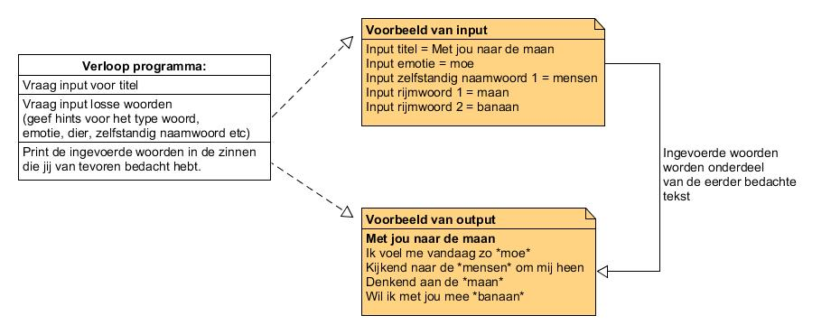

# Introductie & Variabelen & Input

* Je leert `print()` statements maken en zo waarden te printen.
* Je leert variables opslaan, oproepen en waar nodig overschrijven.
* Je leert errors goed genoeg lezen om te begrijpen waar het probleem ligt
en wat het probleem is, om zo de errors te gebruiken om je code te
debuggen.
* Je leert `input()` te gebruiken om de gebruiker te vragen om een
waarde in te voeren.
* Je leert hoe je een ingevoerde waarde moet verwerken in je script.

**{{ runestone_link }}:** 
*0: Hallo!*, *1: Variabelen*, *1E: Foutmeldingen* en *5: Invoer*.

**W3Schools:** [*Python Variables*](https://www.w3schools.com/python/python_variables.asp)

**Extra opdrachten:** [*Variables Exercises*](https://pythonbasics.org/variables/#Exercises)

**Check-out opdracht: Pop-song-schrijver**

Heb je de lesstof begrepen? Dan kun je nu een pop-song-schrijver bouwen. Vraag de gebruiker om input en verwerk dit in je tekst.

* Stap 1: vraag de gebruiker om een titel
* Stap 2: vraag de gebruiker om andere soorten invoer (een zelfstandig naamwoord, een gevoel, iets wat je kunt zien)
* Stap 3: bedenk leuke zinnen waar de ingevoerde woorden in kunnen komen
* Stap 4: maak een print-functie die de invoer invoegt in de door jou bedachte zinnen.

Bijvoorbeeld:

