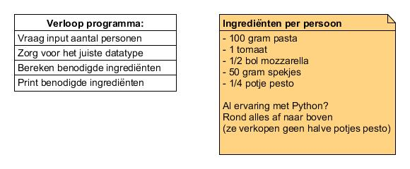

# Functies

* Je leert ingebouwde functions te gebruiken om complexe taken niet zelf
te hoeven coderen.
* Je snapt hoe arguments werken en waarom deze bestaan.

**{{ runestone_link }}:** 
*2: Functies*, *3: Commentaar en aanhalingstekens* (t/m Tekenreeksen) en *4: Types*

**Handige lijst met ingebouwde functies in Python:**
[*Built-in Functions*](https://www.w3schools.com/python/python_ref_functions.asp)

**W3Schools**
Types: [*Python Numbers*](https://www.w3schools.com/python/python_numbers.asp) (geen complex), [*Python Casting*](https://www.w3schools.com/python/python_casting.asp)

**Check-out opdracht: Pasta pesto op kamp**

Heb je de lesstof begrepen? Dan kun je nu een boodschappenlijst-generator bouwen. Vraag de gebruiker om het aantal personen, bereken de ingrediënten en print de lijst.

* Stap 1: vraag de gebruiker het aantal personen
* Stap 2: zorg dat je invoer het juiste data type krijgt
* Stap 3: stel variabelen op die de ingrediënten berekenen
* Stap 4: print de lijst

Bijvoorbeeld:

