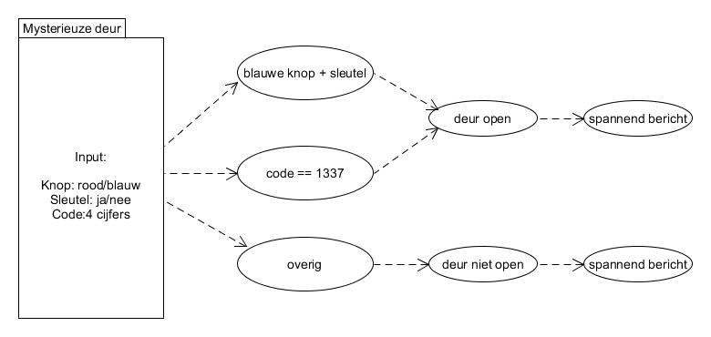

# If/else statements & boolean operators

* Je kan nu if/else-statements en boolean operators gebruiken om
conditionals te maken in een als-dan-anders constructie.

**{{ runestone_link }}:** 
**6: If* en *9: Else, And, Or, Not*

*Let op*: voor de oefening *26 Letters* heb je de functie `ord` nodig, die wordt uitgelegd in deel [7A]({{ runestone_base_url }}/les-07a.html#les-07a-s6). Je kunt die uitleg even lezen (voor ons staat die volgende week op de planning), of die oefening overslaan en voor volgende week bewaren.

**W3Schools:** 
[*input()function*](https://www.w3schools.com/python/ref_func_input.asp)
[*Python Conditions*
](https://www.w3schools.com/python/python_conditions.asp)

**Extra
opdrachten:**
[*If-statements Exercises*](https://pythonbasics.org/if-statements/#Exercise)

**Check-out opdracht: Mysterieuze escape-deur**

Heb je de lesstof begrepen? Dan kun je nu een mysterieuze escape-deur bouwen. 

De speler staat voor een geheime kluisdeur met twee mysterieuze knoppen en een sleutelgat. Om te ontsnappen moeten ze de juiste handelingen combineren.
* Vraag welke knop ze indrukken (rood of blauw), of ze de gouden sleutel hebben omgedraaid (ja of nee), en welke geheime code ze intoetsen (een getal).
* Controleer de ontsnapping:
* De deur gaat alleen open als de blauwe knop is gekozen en de sleutel is omgedraaid, of als ze de geheime mastercode (1337) direct goed hebben.
* Gebruik not of else om te reageren als ze de rode knop kiezen.
* Print een spannend bericht of de ontsnapping is gelukt of dat ze vast blijven zitten.

* Stap 1: print een leuk welkomsbericht
* Stap 2: vraag de gebruiker welke knop hij wil indrukken (rood/blauw)
* Stap 3: vraag de gebruiker of hij de sleutel wil omdraaien (ja/nee)
* Stap 4: vraag de gebruiker welke toegangscode hij wil invoeren (4 cijfers)
* Stap 5: controleer of de deur open moet gaan of niet (if/and/or/else)
* Stap 6: print een spannend bericht waarin je vertelt of het gelukt is en wat er nu gaat gebeuren (eeuwige roem of rechtstreeks naar de hel)

Bijvoorbeeld:

