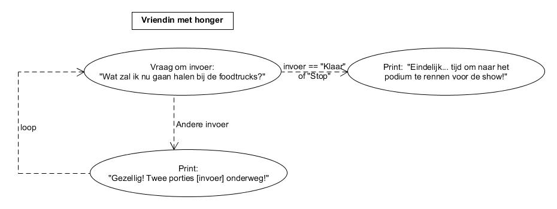

# Loops, indices en beter rekenen en van alles wat

## Leerdoelen

* Je leert for-loops te gebruiken voor vastgestelde ranges of voor alle
karakters in een string.
* Je leert while-loops te gebruiken voor een conditional loop (een loop
die alleen maar werkt als de condition klopt).
* Je leert wanneer je `for` en wanneer `while` moet gebruiken.
* Je leert indices te gebruiken om bepaalde stukken tekst uit een string
op te vragen.
* Je leert nieuwe operators gebruiken om beter, efficienter en leesbaarder
te rekenen, zowel met numbers als met strings.

**{{ runestone_link }}:** 
*7: De editor* (met alle subcategorieën, 7A, 7B, 7C) en *8: Van alles wat*. Dit is een verzameling lastigere opdrachten, die dienen ter herhaling van de stof die je tot nu toe hebt gehad, en deze combineert.

**W3Schools:** [*Python While Loops*](https://www.w3schools.com/python/python_while_loops.asp), [*Python For Loops*](https://www.w3schools.com/python/python_for_loops.asp), [*Python Strings*](https://www.w3schools.com/python/python_strings.asp), [*Python Operators*](https://www.w3schools.com/python/python_operators.asp)

**Extra opdrachten:** 
[*Exercises For Loops*](https://pythonbasics.org/for-loops/#Exercise), 
[*Exercises While Loops*](https://pythonbasics.org/while-loop/#Exercise), 
[*Exercises Strings and Indices*](https://pythonbasics.org/strings/#Exercises)

**Check-out opdracht: Vriendin met honger**

Heb je de lesstof begrepen? Dan kun je nu een programma bouwen die een vriendin met honger simuleert. 

Je bent met een vriendin op een festivalterrein, maar ze kan maar geen genoeg krijgen van snacks en drankjes halen!
Gebruik een while-loop die herhaalt zolang de vriendin nog niet "klaar" of "stop" roept.
Vraag elke ronde: "Wat gaan we nu halen bij de foodtrucks?".
Print bij elke bestelling een vrolijk zinnetje (bijvoorbeeld: "Gezellig! Twee porties [snack] onderweg!").
Zodra ze "klaar" intypt, stopt de loop en print het programma iets als: "Eindelijk... tijd om naar het podium te rennen voor de show! ".

* Stap 1: print een leuk welkomsbericht
* Stap 2: maak een while loop die:
    * vraagt aan de gebruiker wat hij wil eten
    * de invoer verwerkt in een tekst als: gezellig! Twee porties [invoer] onderweg!
    * stopt als de invoer "Stop" of "Klaar" is

Bijvoorbeeld:

