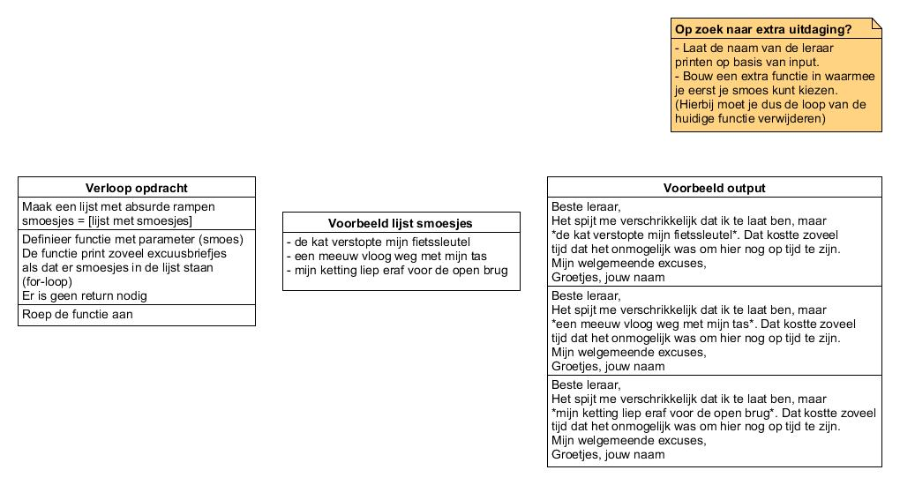

# Zelf functies maken en lijsten

* Je leert functies te gebruiken om vaker uit te voeren stukken code
slechts één keer uit te hoeven typen.
* Je leert functies te gebruiken om je code overzichtelijker en leesbaarder te maken.
* Je leert lists te gebruiken om grote hoeveelheden data in op te slaan.
* Je leert hoe indices werken bij lists.

**{{ runestone_link }}:** 
*10: Functies definiëren* en *11B: De scope van een variabele*, *13: Lijsten (arrays)* en *15A: Komt er een einde aan?* 

**W3Schools:**
[*Python Functions*](https://www.w3schools.com/python/python_functions.asp)
[*Python
Lists*](https://www.w3schools.com/python/python_lists.asp), [*Python
Dictionaries*
](https://www.w3schools.com/python/python_dictionaries.asp)Extra
opdrachten: *Dictionary Exercises*, [*Split
Exercises*](https://pythonbasics.org/split/#Exercises), [*List
Exercises*](https://pythonbasics.org/list-operations/#Exercise)

**Check-out opdracht: Smoesjesgenerator**

Heb je de lesstof begrepen? Dan kun je nu een programma bouwen dat excuusbriefjes voor je print. 

Je bent weer eens veel te laat voor het eerste uur op school. In plaats van steeds hetzelfde saaie excuus te vertellen, programmeer je een applicatie die automatisch een lijst vol dramatische smoesjes print voor je docent.
* Maak een lijst met minimaal 3 absurde ochtendrampen (bijvoorbeeld: de kat verstopte de fietssleutel, een meeuw vloog weg met je tas, de ketting liep eraf voor de open brug).
* Schrijf een eigen functie met 1 parameter (de ramp).
Binnen de functie print je een kort, theatraal excuusbericht waarin de ramp netjes verwerkt is.
* Zorg dat jouw functie voor alle rampen uit de lijst wordt uitgevoerd, zodat er een compleet overzicht aan excuses op het scherm verschijnt.

* Stap 1: stel een lijst met smoesjes op. Begin met 3 smoesjes.
* Stap 2: Stel een functie op die een briefje print met de smoes op de juiste plaats.
    * gebruik een for-loop om te zorgen dat alle smoesjes geprint worden
    

Bijvoorbeeld:

